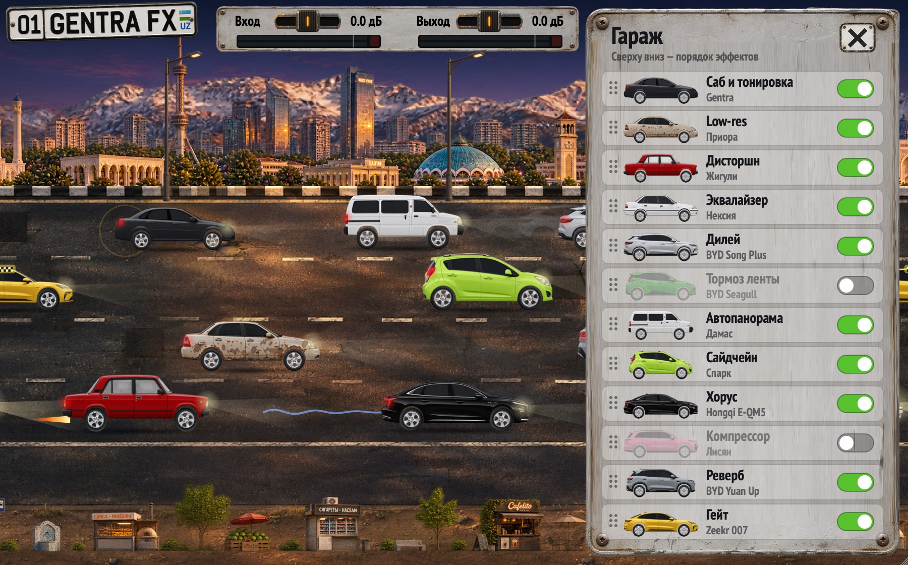
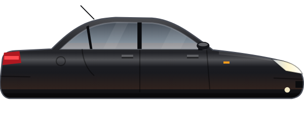
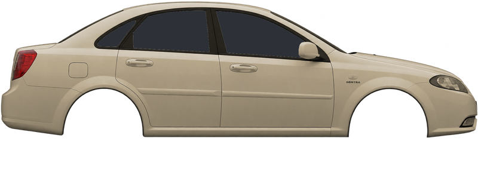
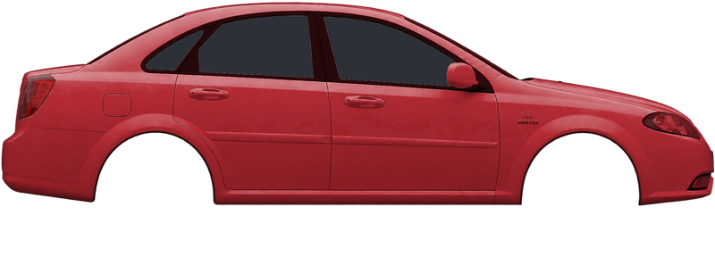
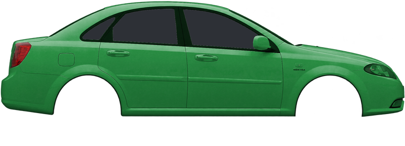
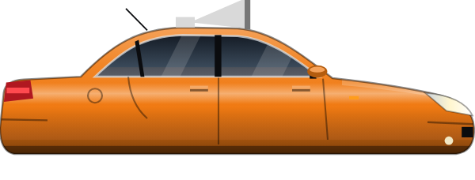
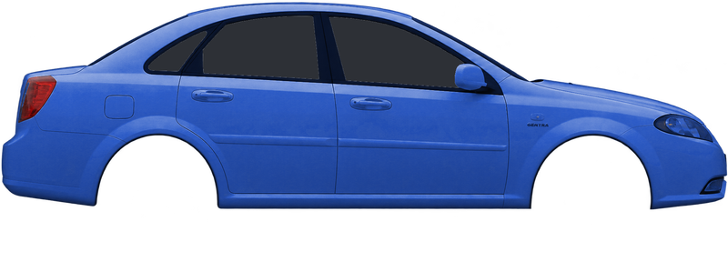
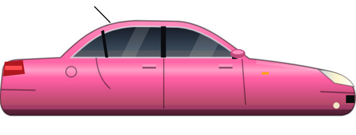
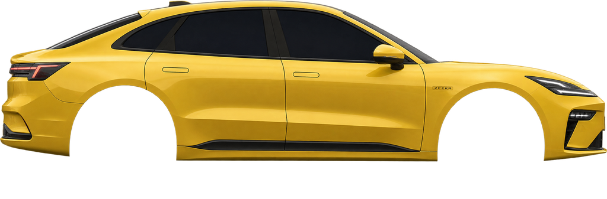

<p align="center">твой новый любимый плагин</p>

<h1 align="center"></h1>

<p align="center">
  <i>«воой акя бу малибу ики турбоми??»</i><br>
  тачки с дорог ташкента специально для твоей поеботы
</p>

<p align="center">
  <a href="https://github.com/lunnaholy/gentra-fx/releases/latest"><b>скачать</b></a> ·
  <a href="https://sauce.emeel.fyi/gentra-fx">сайт</a> ·
  <a href="https://t.me/lnhly">telegram</a>
</p>

<p align="center">VST3 и AU, без растаможки · macOS (apple silicon) и windows (x64)</p>



## шашки по чиланзару

каждая тачка - эффект. это корыто без музыки не тронется, так что чем сильнее крутишь тем быстрее едет

## 12 невероятно оригинальных эффектов

мега очевидное расположение функциональных крутилок в форме колёс машины поможет инклюзивным реперам продолжать писать свой трап

| | тачка | эффект | заднее колесо | на дороге |
|---|---|---|---|---|
|  | gentra | саб и тонировка | подъём низа | кузов качается от баса |
|  | приора | low-res | понижение разрядности и частоты дискретизации | ржавчина гуще с силой эффекта |
|  | жигули | дисторшн | драйв до +36 дБ | пламя из выхлопа |
|  | нексия | эквалайзер | общая громкость ±12 дБ | фары ярче с силой эквализации |
|  | BYD song plus | дилей | время: нота по темпу или 60–600 мс | сзади едут копии |
|  | BYD seagull | тормоз ленты | время остановки 10 мс–5 с | горят стоп-сигналы |
|  | дамас | автопанорама | глубина панорамирования | качается поперёк полосы, мигает поворотник |
|  | спарк | сайдчейн | глубина провала громкости | кузов приседает вместе с провалом |
|  | hongqi E-QM5 | хорус | глубина модуляции | за машиной волна |
|  | лисян | компрессор | порог 0…−36 дБ | кузов сплющивается от подавления |
|  | BYD yuan up | реверб | размер помещения | отражение на асфальте |
|  | zeekr 007 | гейт | глубина гейта | шашки такси горят, пока гейт открыт |

## гараж = цепочка (парковка бесплатная)

- сверху вниз - порядок эффектов. перетаскивай строчку чтобы изменить порядок. нажми и перетащи. там есть за что нажимать. там видно
- с помощью тумблера включай и отключай эффект
- по умолчанию на дороге только чёрная джентра на нуле, остальные ждут тебя в гараже
- порядок, гараж и всё остальное сохраняется в пресете.


<p align="center"><sub>нексия с эквалайзером. да, в нексии есть экран магнитолы, и точки на нём тянутся мышкой.</sub></p>

## приколы

- **DOLBIT NORMALNO** — дорога ловит доли из DAW: сильная бьёт сильнее, а на стопе есть тряска (причина бас).
- **шашки** — тачки перестраиваются, моргают дальним тем, кто тащится, и уступают. скорость каждой зависит от силы эффекта.
- **вход и выход** — ±24 дБ, индикаторы пика L/R и лампа перегруза. двойной клик сбрасывает уровни.
- **окно 60–200%** — тянется за угол, размер сохраняется в пресете.

## установка

скачай архив со страницы [releases](https://github.com/lunnaholy/gentra-fx/releases/latest) и распакуй.

**macOS (apple silicon)** — скопируй:

- `Sauce Gentra FX.vst3` → `~/Library/Audio/Plug-Ins/VST3/`
- `Sauce Gentra FX.component` → `~/Library/Audio/Plug-Ins/Components/`

сборка не подписана apple (растаможка стоит $99 в год), поэтому macOS её блокирует. сними блокировку в терминале и перезапусти DAW:

```
xattr -dr com.apple.quarantine ~/Library/Audio/Plug-Ins/VST3/"Sauce Gentra FX.vst3" ~/Library/Audio/Plug-Ins/Components/"Sauce Gentra FX.component"
```

**windows (64-bit)** — скопируй папку `Sauce Gentra FX.vst3` в `C:\Program Files\Common Files\VST3\`.

## собрать самому

нужны CMake и компилятор C++; JUCE скачается сам.

```
./build.sh          # macOS: собрать, прогнать тесты, поставить VST3 и AU в ~/Library
./build.sh run      # то же и открыть standalone для отладки
```

на windows: `cmake -B build && cmake --build build --config Release`.

релиз собирает GitHub Actions по тегу версии (версия плагина берётся из тега):

```
git tag v1.2.0 && git push origin v1.2.0
```

пробная сборка без релиза — кнопка run workflow во вкладке actions.

<p align="center"></p>

<p align="center"><sub>© 2026 lunnaholy · шрифт PT sans narrow — paratype free font license · сделано на JUCE, чистейший вайбкод</sub></p>
