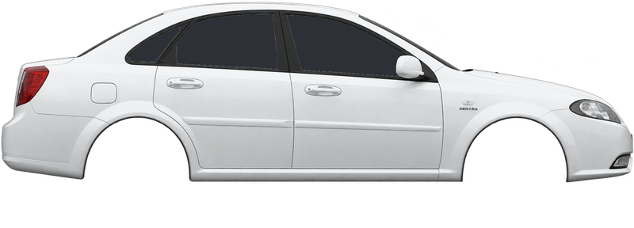
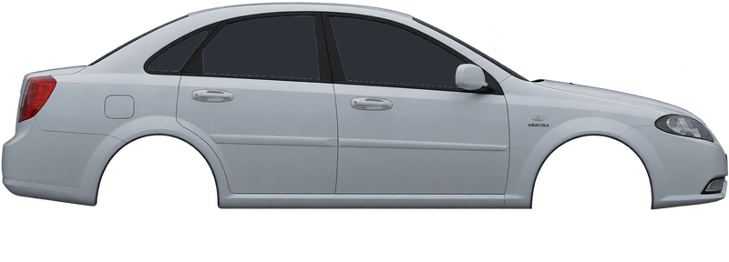
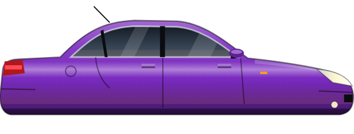
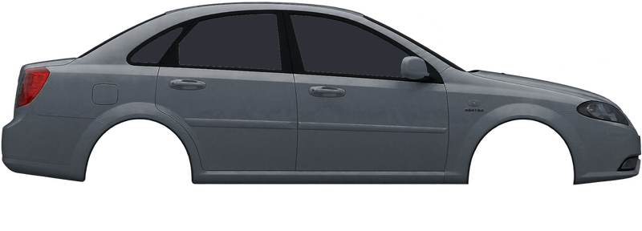
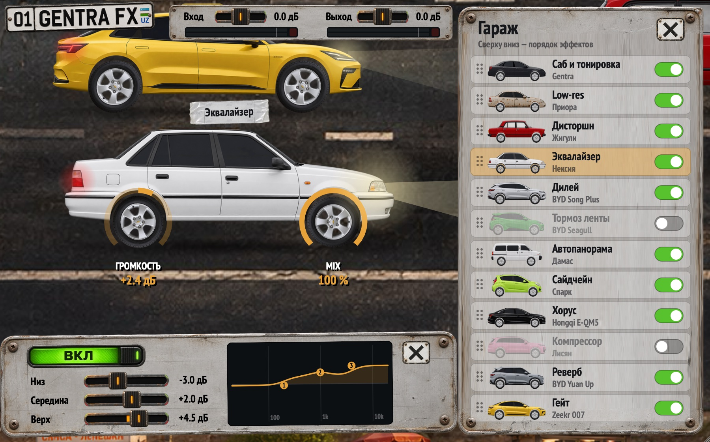

<h1 align="center"></h1>

<p align="center">
  Мультиэффект-плагин: 12 эффектов в одной цепочке, каждый — машина на дороге.<br>
  VST3 и AU · macOS (Apple Silicon), Windows (x64) и Linux (x64)
</p>

<p align="center">
  <a href="https://github.com/lunnaholy/gentra-fx/releases/latest"><b>Скачать</b></a> ·
  <a href="https://sauce.emeel.fyi/gentra-fx">Сайт</a> ·
  <a href="https://t.me/lnhly">Telegram</a>
</p>


## Эффекты

Заднее колесо машины — главная ручка эффекта, остальные параметры — на табличке. Скорость машины зависит от силы эффекта.

| | Машина | Эффект | Главная ручка |
|---|---|---|---|
|  | Gentra | Саб и фильтр нижних частот | Подъём низа |
|  | Приора | Low-res | Понижение разрядности и частоты дискретизации |
|  | Жигули | Дисторшн | Драйв до +36 дБ |
|  | Нексия | Эквалайзер | Общая громкость ±12 дБ |
|  | BYD Song Plus | Дилей | Время: нота по темпу или 60–600 мс |
|  | BYD Seagull | Тормоз ленты | Время остановки 10 мс–5 с |
|  | Дамас | Автопанорама | Глубина панорамирования |
|  | Спарк | Сайдчейн | Глубина провала громкости |
|  | Hongqi E-QM5 | Хорус | Глубина модуляции |
|  | Лисян | Компрессор | Порог 0…−36 дБ |
|  | BYD Yuan Up | Реверб | Размер помещения |
|  | Zeekr 007 | Гейт | Глубина гейта |

## Цепочка

- Гараж — список эффектов сверху вниз в порядке обработки; строки перетаскиваются.
- Тумблер включает и отключает эффект.
- По умолчанию на дороге только Gentra, остальные машины стоят в гараже.
- Вход и выход: ±24 дБ, индикаторы пика L/R и лампа перегруза.
- Окно масштабируется от 60 до 200%.
- Порядок, состав цепочки и размер окна сохраняются в пресете.



## Установка

Скачайте архив со страницы [Releases](https://github.com/lunnaholy/gentra-fx/releases/latest) и распакуйте.

**macOS (Apple Silicon)** — скопируйте:

- `Sauce Gentra FX.vst3` → `~/Library/Audio/Plug-Ins/VST3/`
- `Sauce Gentra FX.component` → `~/Library/Audio/Plug-Ins/Components/`

Сборка не подписана Apple, поэтому macOS её блокирует. Снимите блокировку в Терминале и перезапустите DAW:

```
xattr -dr com.apple.quarantine ~/Library/Audio/Plug-Ins/VST3/"Sauce Gentra FX.vst3" ~/Library/Audio/Plug-Ins/Components/"Sauce Gentra FX.component"
```

**Windows (64-bit)** — скопируйте папку `Sauce Gentra FX.vst3` в `C:\Program Files\Common Files\VST3\`.

**Linux (x64)** — скопируйте папку `Sauce Gentra FX.vst3` в `~/.vst3/`.

## Сборка из исходников

Нужны CMake и компилятор C++; JUCE скачается сам.

```
./build.sh          # macOS: собрать, прогнать тесты, поставить VST3 и AU в ~/Library
./build.sh run      # то же и открыть Standalone для отладки
```

На Windows: `cmake -B build && cmake --build build --config Release`.

На Linux сначала поставьте заголовки (Debian/Ubuntu), потом соберите:

```
sudo apt install build-essential cmake libasound2-dev libx11-dev libxcomposite-dev libxcursor-dev libxext-dev libxinerama-dev libxrandr-dev libxrender-dev libfreetype-dev libfontconfig1-dev
cmake -B build -DCMAKE_BUILD_TYPE=Release && cmake --build build
```

Релиз собирает GitHub Actions по тегу версии (версия плагина берётся из тега):

```
git tag v1.2.0 && git push origin v1.2.0
```

Пробная сборка без релиза — кнопка Run workflow во вкладке Actions.

---

© 2026 lunnaholy · Шрифт PT Sans Narrow — ParaType Free Font License · Сделано на JUCE
